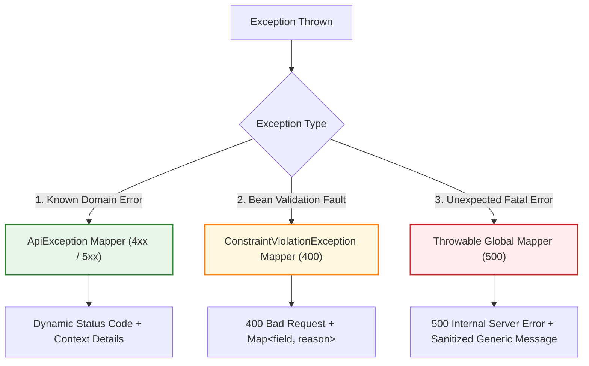

# 🏗️ Modular Architecture Rules (`architecture-rules.md`)

This document defines the architectural rules, module boundaries, and separation of responsibilities for multi-module libraries and services in the organization, exemplified by `ExceptionHandlerCT`.

---

## 1. Modular Separation of Concerns

### 1.1. Strict Inward Dependency Flow
- **Dependencies must strictly point inwards towards the core**:
  ```mermaid
  flowchart LR
      Consumer["Consuming Application"] --> Adapter["Integration Module\n(e.g., quarkus-exceptions-handler)"]
      Adapter --> Core["Core Domain Module\n(e.g., core-exceptions)"]

      classDef core fill:#e1f5fe,stroke:#0288d1,stroke-width:2px;
      classDef adapter fill:#e8f5e9,stroke:#388e3c,stroke-width:2px;
      classDef consumer fill:#fff3e0,stroke:#f57c00,stroke-width:2px;

      class Core core;
      class Adapter adapter;
      class Consumer consumer;
  ```
- **The Core module must NEVER depend on integration modules, frameworks, or web transport libraries**.
- Consuming applications import the framework-specific integration module, inheriting the core transitively.

### 1.2. The Zero-Dependency Core Rule
- The `core-*` module must remain **100% pure Java (Java 21+)** with **zero external runtime dependencies**.
- It must never contain annotations or imports from:
  - Quarkus, Spring, Micronaut, or any DI framework
  - Jakarta REST (`jakarta.ws.rs.*`), JAX-RS, or Servlet APIs
  - JSON libraries (Jackson, JSON-B) or logging implementations
- ❌ **INCORRECT:**
  ```java
  // In core-exceptions:
  import jakarta.ws.rs.core.Response; // FORBIDDEN in core
  import io.quarkus.runtime.annotations.RegisterForReflection; // FORBIDDEN in core

  public class NotFound extends ApiException { ... }
  ```
- ✅ **CORRECT:**
  ```java
  // In core-exceptions: Pure Java 21 standard library only
  package com.cifertech.exceptionhandler.exceptions._4xx;

  import com.cifertech.exceptionhandler.exceptions.ApiException;
  import com.cifertech.exceptionhandler.exceptions.HttpCode;
  import java.util.Map;

  public class NotFound extends ApiException { ... }
  ```

---

## 2. Module Responsibilities & Boundaries

| Layer / Module | Allowed Responsibilities | Forbidden Responsibilities |
|---|---|---|
| **Core Module** (`core-exceptions`) | - Base exceptions (`ApiException`)<br>- Domain error catalog (`_4xx`, `_5xx`)<br>- HTTP status code abstractions (`HttpCode`)<br>- Pure Java data holders / details | - Generating HTTP responses (`Response.status`)<br>- Framework annotations (`@Provider`, `@Inject`)<br>- Framework configuration properties<br>- Logging framework bindings |
| **Integration Module** (`*-handler`) | - JAX-RS / Jakarta REST `@Provider` mappers<br>- Mapping exceptions to HTTP status and JSON entities<br>- MicroProfile Config integration (`@ConfigProperty`)<br>- Input validation mapping (`ConstraintViolationException`)<br>- Safe logging at system boundary (`Logger.log`) | - Defining business domain exceptions<br>- Duplicating core error codes<br>- Exposing internal stack traces to HTTP clients |
| **Consuming App** | - Throwing domain exceptions from resources/services<br>- Customizing configuration via `application.properties` | - Manually handling/wrapping try-catch for standard HTTP errors<br>- Manually constructing error JSON bodies |

---

## 3. Framework Integration & Auto-Discovery Rules

### 3.1. Zero-Configuration Contract via Jandex
- Integration modules designed for Quarkus **must** index classes using `jandex-maven-plugin` during compilation:
  ```xml
  <plugin>
      <groupId>io.smallrye</groupId>
      <artifactId>jandex-maven-plugin</artifactId>
      <executions>
          <execution>
              <id>make-index</id>
              <goals><goal>jandex</goal></goals>
          </execution>
      </executions>
  </plugin>
  ```
- Consuming microservices must never be required to register `@Provider` classes manually in `beans.xml` or custom configuration classes.

### 3.2. Configurable Defaults via MicroProfile Config
- Any fallback messages, error templates, or environment flags must be exposed through MicroProfile Config annotations (`@ConfigProperty`) with sensible defaults:
  ```java
  @ConfigProperty(
      name = "exception.handler.default-message",
      defaultValue = "Oops, something unexpected happens"
  )
  String defaultMessage;
  ```

---

## 4. Exception Handling & Security Architecture

### 4.1. Three-Tier Handler Hierarchy
Framework integration modules must implement a deterministic, 3-tier exception mapper hierarchy:



### 4.2. Information Leakage Prevention
- **Never expose Java stack traces, database query fragments, or internal hostnames** in the HTTP response body for uncaught `Throwable` exceptions.
- Stack traces must be recorded strictly to server logs (`Level.SEVERE`) at the integration boundary, while the HTTP client receives a sanitized, generic message.

### 4.3. Structured Validation Mapping
- Validation exceptions (`ConstraintViolationException`) must extract the leaf property name and violation message into a normalized key-value map (`Map<String, String>`), never dumping the raw `ConstraintViolation` object graph.

---

## 5. Build, Packaging & Versioning Rules

### 5.1. Multi-Module Parent POM Hierarchy
- All submodules must declare the root project as `<parent>`.
- The parent POM defines:
  - Centralized compiler targets (`maven.compiler.source` and `target` set to 21)
  - Common plugin configurations (license formatting, source attachment, Javadoc, GPG signing)
  - Unified CI-friendly version token (`<version>${revision}</version>`) using `flatten-maven-plugin`.

### 5.2. Strict Transitive Dependency Export
- The integration module must declare the core module as a direct compile dependency:
  ```xml
  <dependency>
      <groupId>${project.groupId}</groupId>
      <artifactId>core-exceptions</artifactId>
      <version>${project.version}</version>
  </dependency>
  ```
- Web API dependencies (`jakarta.ws.rs-api`, `jakarta.validation-api`, `microprofile-config-api`) in integration modules must be marked `<scope>provided</scope>` so they are supplied by the host runtime (Quarkus/RESTEasy) without causing dependency bloat or classpath collisions.

---

## 6. Continuous Documentation & Versioning Rules

### 6.1. Module Documentation Synchronization (`.agents/modules/`)
- Every code modification, new feature, or module refactoring **must** update the corresponding documentation in [`.agents/modules/`](file:///home/yacson/Proyectos/cifertech/ExcepptionHandlerCT/ExceptionHandlerCT/.agents/modules).
- When adding a new module, a new `.md` file must be authored describing its responsibilities, dependencies, and class diagrams, and it must be registered in [`.agents/modules/README.md`](file:///home/yacson/Proyectos/cifertech/ExcepptionHandlerCT/ExceptionHandlerCT/.agents/modules/README.md).

### 6.2. Root README Maintenance
- When changes affect public API usage, supported features, configuration options, or dependency snippets, the root [`README.md`](file:///home/yacson/Proyectos/cifertech/ExcepptionHandlerCT/ExceptionHandlerCT/README.md) must be updated synchronously.

### 6.3. Semantic Version Bumping in `pom.xml`
- Any functional change, fix, or new capability **must** increment the `<revision>` property in the root [`pom.xml`](file:///home/yacson/Proyectos/cifertech/ExcepptionHandlerCT/ExceptionHandlerCT/pom.xml) following Semantic Versioning (`MAJOR.MINOR.PATCH`).
- Unversioned changes are considered incomplete and violate project governance.
