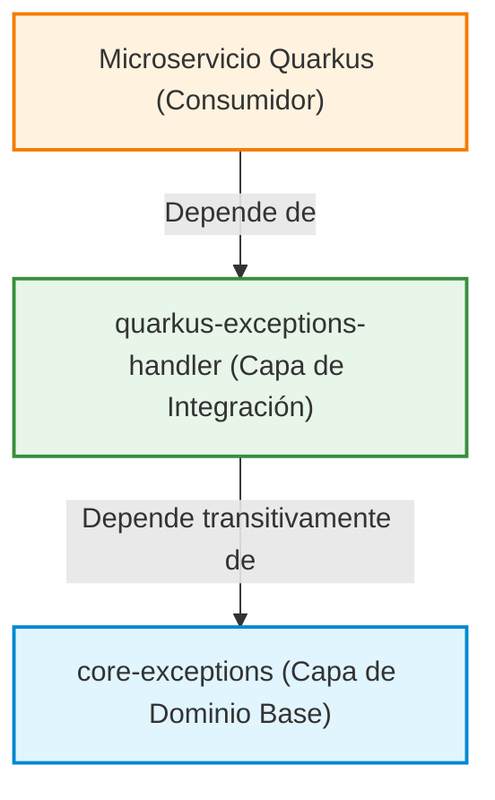
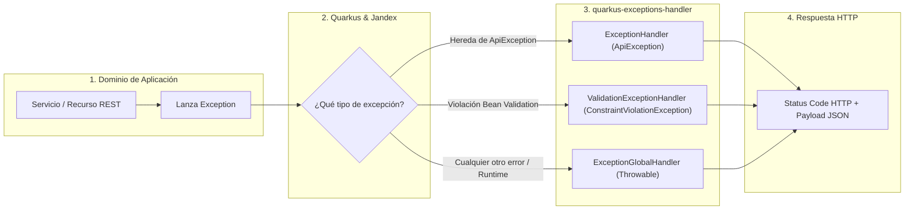

# Arquitectura Modular de ExceptionHandlerCT

`ExceptionHandlerCT` es una solución diseñada para estandarizar el manejo de errores en microservicios basados en **Java 21** y **Quarkus**. El proyecto adopta una arquitectura modular desacoplada mediante Maven Multi-Module, separando la definición de dominios de error de la capa de integración con el framework.

---

## 🏛️ Estructura de Módulos

El repositorio se compone de dos módulos principales con responsabilidades estrictamente delimitadas:

---

## 📚 Índice de Documentación de Módulos

| Módulo | Documentación Detallada | Responsabilidad Principal | Dependencias Externas |
|---|---|---|---|
| [`core-exceptions`](file:///home/yacson/Proyectos/cifertech/ExcepptionHandlerCT/ExceptionHandlerCT/.agents/modules/core-exceptions.md) | [Ver core-exceptions.md](file:///home/yacson/Proyectos/cifertech/ExcepptionHandlerCT/ExceptionHandlerCT/.agents/modules/core-exceptions.md) | Catálogo de excepciones HTTP (4xx y 5xx), códigos de estado y excepciones base. | **Ninguna** (Java 21 Puro) |
| [`quarkus-exceptions-handler`](file:///home/yacson/Proyectos/cifertech/ExcepptionHandlerCT/ExceptionHandlerCT/.agents/modules/quarkus-exceptions-handler.md) | [Ver quarkus-exceptions-handler.md](file:///home/yacson/Proyectos/cifertech/ExcepptionHandlerCT/ExceptionHandlerCT/.agents/modules/quarkus-exceptions-handler.md) | Interceptores `@Provider` (`ExceptionMapper`), indexación Jandex y serialización JSON. | Jakarta REST, Jakarta Validation, MicroProfile Config |

---

## 🔄 Flujo Global de Intercepción

Cuando un microservicio Quarkus incluye `quarkus-exceptions-handler`, Quarkus detecta automáticamente los mappers gracias al índice Jandex empaquetado en el JAR.

---

## 💡 Ventajas de este Diseño

1. **Agnosticismo del Núcleo (`core-exceptions`)**:
   - Puede ser utilizado en cualquier proyecto Java (Spring Boot, Micronaut, bibliotecas internas CLI) sin arrastrar Quarkus ni dependencias de frameworks.
2. **Auto-descubrimiento en Quarkus**:
   - Gracias a `jandex-maven-plugin`, no se requiere registrar manualmente los proveedores en `beans.xml` ni añadir clases al scanner de CDI.
3. **Contrato de Respuesta Homogéneo**:
   - Todos los microservicios de la organización devuelven una estructura JSON coherente para errores 4xx y 5xx.
