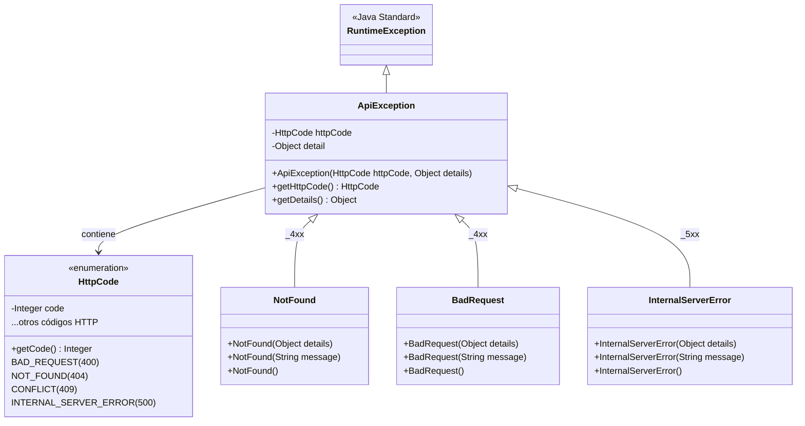

# Módulo: core-exceptions

El módulo [`core-exceptions`](file:///home/yacson/Proyectos/cifertech/ExcepptionHandlerCT/ExceptionHandlerCT/core-exceptions) constituye el núcleo agnóstico del ecosistema `ExceptionHandlerCT`. Proporciona un catálogo completo de excepciones tipadas correspondientes a los códigos de error HTTP estándar (4xx y 5xx).

---

## 🎯 Principio de Diseño

- **Agnóstico de Frameworks:** No depende de Quarkus, Spring, Jakarta REST ni de ninguna biblioteca externa. Es **Java 21 estándar y puro**.
- **Inmutabilidad y Flexibilidad:** Todas las excepciones heredan de `ApiException`, la cual encapsula el código HTTP (`HttpCode`) y una carga útil estructurada (`detail`).
- **Seguridad en Serialización:** Los atributos `httpCode` y `detail` están marcados como `transient` para evitar fugas de estado no deseadas en contextos de serialización estándar.

---

## 🏛️ Jerarquía de Clases



---

## 🧩 Componentes Principales

### 1. `ApiException`
Es la clase base para todas las excepciones del catálogo:
```java
package com.cifertech.exceptionhandler.exceptions;

public class ApiException extends RuntimeException {
    private final transient HttpCode httpCode;
    private final transient Object detail;

    public ApiException(HttpCode httpCode, Object details) {
        this.httpCode = httpCode;
        this.detail = details;
    }

    public HttpCode getHttpCode() { return httpCode; }
    public Object getDetails() { return detail; }
}
```

### 2. `HttpCode`
Enum que mapea semánticamente los códigos numéricos HTTP según RFCs:
- **4xx Client Errors:** 400 (`BAD_REQUEST`), 401 (`UNAUTHORIZED`), 403 (`FORBIDDEN`), 404 (`NOT_FOUND`), 409 (`CONFLICT`), 422 (`UNPROCESSABLE_ENTITY`), etc.
- **5xx Server Errors:** 500 (`INTERNAL_SERVER_ERROR`), 501 (`NOT_IMPLEMENTED`), 502 (`BAD_GATEWAY`), 503 (`SERVICE_UNAVAILABLE`), 504 (`GATEWAY_TIMEOUT`), etc.

---

## 📦 Catálogo de Excepciones

Las excepciones se dividen en dos paquetes según la categoría de error HTTP:

### Paquete `com.cifertech.exceptionhandler.exceptions._4xx`
| Excepción | Código HTTP | Caso de Uso Típico |
|---|---|---|
| `BadRequest` | 400 | Datos de entrada con formato inválido o parámetros faltantes. |
| `Unauthorized` | 401 | Credenciales de autenticación ausentes o erróneas. |
| `PaymentRequired` | 402 | Acceso a función que requiere suscripción o pago. |
| `Forbidden` | 403 | El usuario autenticado no posee los permisos requeridos. |
| `NotFound` | 404 | Recurso o entidad no encontrada en la base de datos. |
| `MethodNotAllowed` | 405 | Verbo HTTP no soportado para la ruta solicitada. |
| `Conflict` | 409 | Conflicto de estado (e.g. violación de unicidad / duplicados). |
| `Gone` | 410 | Recurso que existía pero ya fue eliminado permanentemente. |
| `PayloadTooLarge` | 413 | Carga o archivo subido excede el límite permitido. |
| `UnsupportedMediaType` | 415 | Content-Type no soportado por el endpoint. |
| `UnprocessableEntity` | 422 | Error semántico de negocio en los datos válidos sintácticamente. |
| `TooManyRequests` | 429 | Límite de tasa (Rate Limiting) alcanzado. |

*(Incluye además: `IAmATeapot`, `Locked`, `FailedDependency`, `TooEarly`, `UpgradeRequired`, `PreconditionRequired`, `RangeNotSatisfiable`, `ExpectationFailed`, `MisdirectedRequest`, `UnavailableForLegalReasons`, `RequestHeaderFieldsTooLarge`, `LengthRequired`, `NotAcceptable`, `RequestTimeout`, `UriTooLong`, `PreconditionFailed`, `ProxyAuthenticationRequired`).*

### Paquete `com.cifertech.exceptionhandler.exceptions._5xx`
| Excepción | Código HTTP | Caso de Uso Típico |
|---|---|---|
| `InternalServerError` | 500 | Falla inesperada durante el procesamiento interno. |
| `NotImplemented` | 501 | Funcionalidad aún no implementada. |
| `BadGateway` | 502 | Error recibido desde un microservicio o API externa río abajo. |
| `ServiceUnavailable` | 503 | Servicio en mantenimiento o sobrecargado. |
| `GatewayTimeout` | 504 | Tiempo de espera agotado al consultar un servicio externo. |
| `HttpVersionNotSupported` | 505 | Versión HTTP de la petición no soportada. |
| `InsufficientStorage` | 507 | Servidor sin espacio en disco o recursos de almacenamiento. |
| `LoopDetected` | 508 | Bucle infinito detectado en procesamiento o redirección. |

*(Incluye además: `VariantAlsoNegotiates`, `NotExtended`, `NetworkAuthenticationRequired`).*

---

## 🛠️ Modos de Instanciación

Cada clase de excepción ofrece tres sobrecargas de constructor para adaptarse al nivel de detalle requerido:

```java
// 1. Con un String simple (se empaqueta automáticamente como Map {"message": "..."})
throw new NotFound("El usuario con ID 42 no existe");

// 2. Con un objeto estructurado (Map, DTO personalizado, lista de errores)
Map<String, Object> errorContext = Map.of(
    "code", "USR_ALREADY_EXISTS",
    "field", "email",
    "attemptedValue", email
);
throw new Conflict(errorContext);

// 3. Constructor sin argumentos (el handler usará el mensaje por defecto configurado)
throw new BadRequest();
```
