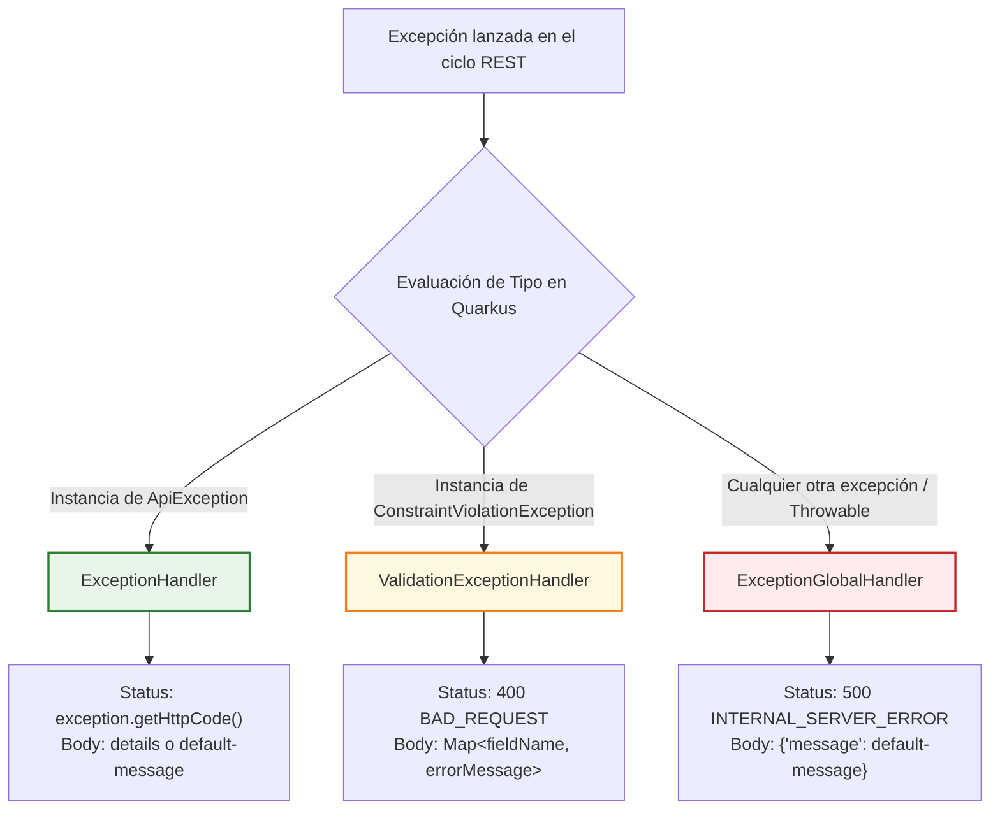
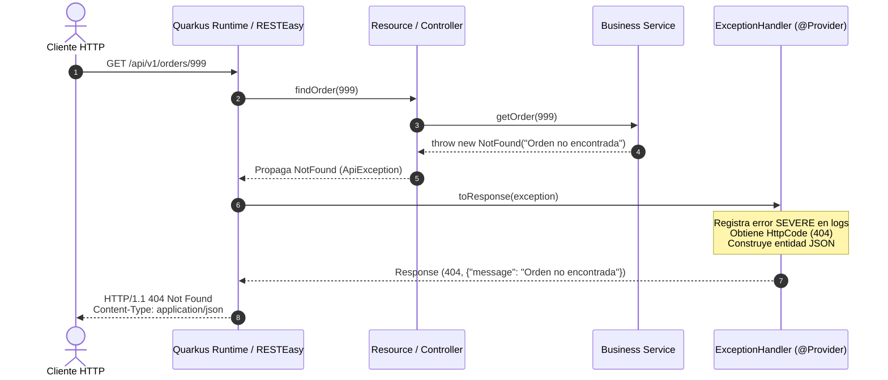

# Módulo: quarkus-exceptions-handler

El módulo [`quarkus-exceptions-handler`](file:///home/yacson/Proyectos/cifertech/ExcepptionHandlerCT/ExceptionHandlerCT/quarkus-exceptions-handler) es la capa de integración para aplicaciones **Quarkus** y estándares **Jakarta REST**. Transforma automáticamente excepciones de dominio y validaciones en respuestas HTTP con formato JSON estandarizado.

---

## 🎯 Principio de Funcionamiento

- **Auto-descubrimiento (Zero Config):** El módulo utiliza `jandex-maven-plugin` para generar el índice Jandex (`META-INF/jandex.idx`) durante la compilación. Quarkus detecta automáticamente todas las clases anotadas con `@Provider` sin necesidad de registrarlas en `beans.xml` ni en la configuración de la aplicación.
- **Jerarquía de Mapeo Determinista:** Jakarta REST evalúa la excepción lanzada y selecciona el `ExceptionMapper` con el tipo más específico en la jerarquía de herencia.

---

## 🧩 Los Tres Mappers Especializados



---

### 1. `ExceptionHandler` (`ExceptionMapper<ApiException>`)
Mapea cualquier excepción proveniente de [`core-exceptions`](file:///home/yacson/Proyectos/cifertech/ExcepptionHandlerCT/ExceptionHandlerCT/core-exceptions) (`NotFound`, `BadRequest`, `Conflict`, etc.).

* **Código HTTP:** Determinado dinámicamente según `exception.getHttpCode().getCode()`.
* **Payload:** 
  * Si la excepción tiene un detalle (`getDetails() != null`), lo devuelve directamente como cuerpo JSON.
  * Si la excepción no tiene detalle (`null`), inyecta el mensaje por defecto configurado (`exception.handler.default-message`).
* **Logging:** Registra la traza con nivel `Level.SEVERE`.

---

### 2. `ValidationExceptionHandler` (`ExceptionMapper<ConstraintViolationException>`)
Captura las violaciones producidas por **Hibernate Validator** o **Jakarta Bean Validation** (por ejemplo, anotaciones `@NotNull`, `@Size`, `@Email` en DTOs o parámetros de endpoint).

* **Código HTTP:** `400 BAD_REQUEST`.
* **Transformación Inteligente:** Procesa cada `ConstraintViolation` extrayendo el nombre limpio del campo (último segmento de `propertyPath`) y su mensaje de validación:
  ```java
  Map<String, String> details = exception.getConstraintViolations().stream()
      .collect(toMap(
          ValidationExceptionHandler::getFieldName,
          ConstraintViolation::getMessage
      ));
  ```
* **Ejemplo de Respuesta JSON:**
  ```json
  {
    "email": "must be a well-formed email address",
    "age": "must be greater than or equal to 18"
  }
  ```

---

### 3. `ExceptionGlobalHandler` (`ExceptionMapper<Throwable>`)
Actúa como **red de seguridad final** para cualquier error imprevisto (ej. `NullPointerException`, caídas de base de datos, desbordamientos, etc.).

* **Código HTTP:** `500 INTERNAL_SERVER_ERROR`.
* **Seguridad de Datos:** No expone trazas internas (`stack traces`) ni información técnica sensible al cliente externo. Devuelve un mensaje genérico configurable.
* **Logging:** Registra la traza completa internamente con nivel `Level.SEVERE` para auditoría y depuración en los logs del servidor.

---

## ⏱️ Diagrama de Secuencia

El siguiente diagrama ilustra el flujo de una petición que falla por un recurso no encontrado:



---

## ⚙️ Configuración (MicroProfile Config)

Los handlers permiten personalizar el mensaje por defecto mediante propiedades estándar de Quarkus en `src/main/resources/application.properties`:

```properties
# Mensaje devuelto cuando una excepción no tiene detalles o ante un error 500 no controlado
# Valor por defecto: "Oops, something unexpected happens"
exception.handler.default-message=Ha ocurrido un error inesperado. Por favor contacte a soporte.
```

---

## 📦 Integración en un Proyecto Quarkus

Para utilizar este manejador global en cualquier microservicio, basta con agregar una única dependencia al `pom.xml` del microservicio consumidor:

```xml
<dependency>
    <groupId>io.github.yacson3287</groupId>
    <artifactId>quarkus-exceptions-handler</artifactId>
    <version>1.0.4</version>
</dependency>
```

> [!NOTE]
> No es necesario agregar `core-exceptions` explícitamente en el proyecto consumidor, ya que es una dependencia transitiva directa de `quarkus-exceptions-handler`.
